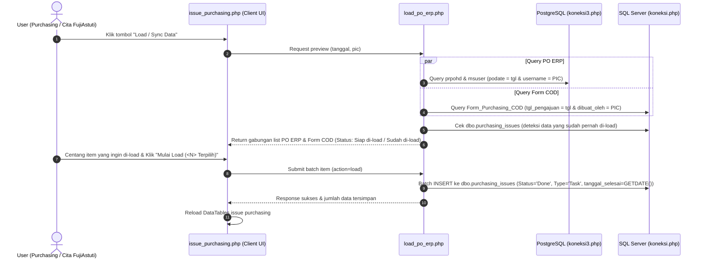

# Implementation Plan - Modul Issue Purchasing & Dual Auto-Load (PO ERP & Form COD)

Pembuatan modul baru **Issue Purchasing** di folder `gg_app/pages/purchasing/issue_purchasing/` yang mengadopsi tampilan dan fitur lengkap seperti `/gg_app/pages/issues/`, dengan penambahan fitur unggulan **Auto-Load / Sync Data Otomatis** dari 2 sumber:
1. **PO ERP Crystal SUM** (PostgreSQL via [koneksi3.php](file:///c:/xampp/htdocs/gg_app/koneksi3.php), tabel `prpohd` & `msuser`)
2. **Form Pengajuan COD** (SQL Server via [koneksi.php](file:///c:/xampp/htdocs/gg_app/koneksi.php), tabel `Form_Purchasing_COD`)

Seluruh data hasil sync disimpan ke tabel `dbo.purchasing_issues` di SQL Server dengan status default `Done`, type `Task`, dan dilengkapi nama issue berisikan nomor referensi PO serta jam pembuatannya. Modul ini juga mendukung pencatatan issue manual.

---

## User Review Required

> [!IMPORTANT]
> **Keputusan Desain Terverifikasi dari Sesi Interview (/grill-me):**
> 1. **Dua Sumber Data Auto-Sync**:
>    - **PO ERP Crystal SUM**:
>      - Format Nama Issue: `Pembuatan PO (NO_PO) Jam HH:mm`
>      - Contoh: `Pembuatan PO (POLC/2610/0421) Jam 10:59`
>      - Jam diambil dari `prpohd.createdate`, PIC dari `msuser.username`.
>    - **Form Pengajuan Cash On Delivery (COD)**:
>      - Format Nama Issue: `Pembuatan Pengajuan Cash On Delivery (REF_PO_NO) Jam HH:mm`
>      - Contoh Nyata Database: `Pembuatan Pengajuan Cash On Delivery (POJT/2610/0048) Jam 08:40`
>      - Jam diambil dari `Form_Purchasing_COD.created_at`, PIC dari `Form_Purchasing_COD.dibuat_oleh`, No PO dari `ref_po_no`.
>      - Deskripsi Issue COD: Lengkap memuat Nomor Tiket, Supplier, dan Keterangan (contoh: `Auto-sync Form COD: COD-261024-002 - AMAN SOLUSI UTAMA (JASA ANGKUTAN PENJUALAN)`).
> 2. **Tampilan Modal Sync**:
>    - Satu tabel daftar terpadu (Unified List) dengan label/badge pembeda: `<span class="badge badge-info">PO ERP</span>` dan `<span class="badge badge-warning">Pengajuan COD</span>`.
>    - User dapat mencentang (Select All atau pilih per baris) dan menekan 1 tombol untuk load sekaligus.
> 3. **Pencegahan Duplikasi Independen**:
>    - PO ERP dicek melalui: `issue_name LIKE '%Pembuatan PO (' + ponmbr + ')%'`
>    - Form COD dicek melalui: `issue_name LIKE '%Pembuatan Pengajuan Cash On Delivery (' + ref_po_no + ')%'`
>    - Kedua jenis issue untuk nomor PO yang sama tidak saling mengunci karena memiliki prefix nama yang berbeda.
> 4. **Tabel Penyimpanan**: Menggunakan tabel khusus `dbo.purchasing_issues` di SQL Server (tanpa perlu ALTER TABLE).
> 5. **Status & Waktu**: Status langsung **`Done`**, Type **`Task`**, dan `tanggal_selesai = GETDATE()`.
> 6. **Filter Default**: Tanggal hari ini (`CURRENT_DATE`), PIC otomatis user yang login (`$_SESSION['NamaLengkap']` / `Cita Fujiastuti`), dengan opsi ubah tanggal dan dropdown PIC bagi akun Admin/Supervisor.

---

## Proposed Architecture & Workflow



---

## Proposed Changes

Direktori: `c:\xampp\htdocs\gg_app\pages\purchasing\issue_purchasing\`

### 1. Backend Core & Sync Engine

#### [NEW] `load_po_erp.php`
- Endpoint AJAX pemrosesan sinkronisasi 2 sumber:
  - **Action `preview`**:
    - Menerima parameter `tanggal` (default hari ini) dan `pic` (default `$_SESSION['NamaLengkap']`).
    - **Sumber 1 (PO ERP)**:
      ```sql
      SELECT h.pohdid, h.ponmbr, h.podate, h.createdate, h.povendorname, u.username as initiator_name
      FROM prpohd h
      LEFT JOIN msuser u ON h.poinitiatorid = u.initiatorid
      WHERE DATE(h.podate) = :podate
        AND LOWER(TRIM(u.username)) = LOWER(TRIM(:pic))
      ORDER BY h.createdate ASC, h.ponmbr ASC
      ```
    - **Sumber 2 (Form Pengajuan COD)**:
      ```sql
      SELECT id, ticket, ref_po_no, tgl_pengajuan, created_at, supplier, keterangan, dibuat_oleh
      FROM Form_Purchasing_COD
      WHERE CAST(tgl_pengajuan AS DATE) = ?
        AND LOWER(TRIM(dibuat_oleh)) = LOWER(TRIM(?))
        AND (is_deleted IS NULL OR is_deleted = 0)
      ORDER BY created_at ASC
      ```
    - Pengecekan ke `dbo.purchasing_issues` untuk menentukan status `is_loaded: true/false`.
    - Mengembalikan array terpadu dengan metadata: `source_type` ('PO_ERP' atau 'COD'), `ref_no`, `time_str`, `vendor_or_supplier`, `keterangan`, `is_loaded`.
  - **Action `load`**:
    - Menerima array item terpilih (`items: [{source_type, id/po_number}, ...]`).
    - Validasi anti-duplikasi ulang.
    - Simpan ke `dbo.purchasing_issues`:
      - **Jika PO ERP**:
        - `issue_name`: `"Pembuatan PO (" . $ponmbr . ") Jam " . date('H:i', strtotime($createdate))`
        - `description`: `"Auto-generated dari PO ERP Crystal SUM (" . $ponmbr . " - " . $vendor . ")"`
      - **Jika Form COD**:
        - `issue_name`: `"Pembuatan Pengajuan Cash On Delivery (" . $ref_po_no . ") Jam " . date('H:i', strtotime($created_at))`
        - `description`: `"Auto-sync Form COD: " . $ticket . " - " . $supplier . " (" . $keterangan . ")"`
      - Kolom bersama:
        - `issue_type`: `'Task'`
        - `status`: `'Done'`
        - `priority`: `'Normal'`
        - `due_date`: `$tanggal`
        - `tanggal_selesai`: `GETDATE()`
        - `created_by`: `$_SESSION['NamaLengkap']`
        - `departemen`: `'Purchasing'`
        - `bagian`: `'Purchasing'`

#### [NEW] `issue_purchasing_serverside.php`
- Server-side DataTables handler untuk `dbo.purchasing_issues`:
  - Pagination, Search multi-kolom, Sorting.
  - Filter Scope (Aktif, Selesai, Semua), Kategori, Rentang Tanggal, Status.

#### [NEW] `save_issue.php`
- Endpoint untuk penanganan operasi manual:
  - `action=add`, `action=edit`, `action=delete`, `action=mark_done`.

#### [NEW] `get_issue_detail.php`
- Mengambil detail 1 issue (JSON) untuk modal View dan modal Edit.

#### [NEW] `data_categories.php`
- Helper inisialisasi kategori purchasing sederhana (`'Umum'`, `'Administrasi Purchasing'`) jika `purchasing_issue_categories` kosong.

---

### 2. Frontend User Interface

#### [NEW] `issue_purchasing.php`
- Halaman utama modul Issue Purchasing:
  - KPI Dashboard Cards (Total, Aktif, Selesai, Hari Ini).
  - Action Toolbar:
    - Tombol **Load / Sync Data** (dengan ikon cloud sync interaktif).
    - Tombol **+ Issue Baru** (Manual).
    - Filter Scope, Kategori, Rentang Tanggal, Status.
  - DataTables interaktif responsif.

#### [NEW] `modal_load_po.php`
- Modal dialog untuk proses Load / Sync Data:
  - Input Tanggal (default: hari ini).
  - Indikator / Dropdown PIC (`Cita Fujiastuti`).
  - Tombol "Cek Data".
  - Tabel Unified Preview:
    - Checkbox (Select All).
    - Tipe Sumber (`[PO ERP]` badge biru, `[Pengajuan COD]` badge kuning/oranye).
    - Nomor Ref PO.
    - Jam Pembuatan (cth: `08:40`, `10:59`).
    - Vendor / Supplier & Keterangan.
    - Status (`Siap di-load` hijau vs `Sudah pernah di-load` abu-abu disabled).
  - Tombol aksi "Mulai Load (<N> Item Terpilih)".

#### [NEW] `modal_add_issue.php`, `modal_edit_issue.php`, `modal_view_issue.php`
- Modal lengkap untuk tambah manual, edit data, dan view detail issue purchasing.

---

## Verification Plan

### Automated / Backend Verification
1. Jalankan test script untuk memverifikasi query kedua tabel:
   - PostgreSQL `prpohd` & `msuser` untuk PO ERP
   - SQL Server `Form_Purchasing_COD` untuk pengajuan COD tanggal `2026-10-24` atas nama `'Cita Fujiastuti'`
   - Memastikan baris `COD-261024-002` dengan `ref_po_no = 'POJT/2610/0048'` dan jam `08:40` terbaca tepat.
2. Uji simulasi batch insert ke `dbo.purchasing_issues` untuk kedua tipe dan verifikasi data tersimpan dengan format nama yang benar.

### Manual Verification
1. Buka `http://localhost/gg_app/pages/purchasing/issue_purchasing/issue_purchasing.php`.
2. Klik tombol **Load / Sync Data**:
   - Verifikasi modal menampilkan data dari kedua sumber (PO ERP dan Form COD).
   - Pastikan muncul baris `Pembuatan Pengajuan Cash On Delivery (POJT/2610/0048) Jam 08:40`.
   - Centang dan klik "Mulai Load".
3. Periksa tabel utama Issue Purchasing:
   - Verifikasi data issue baru muncul dengan status `Done` dan deskripsi lengkap.
4. Buka kembali modal Load/Sync:
   - Verifikasi item yang baru di-load sudah berstatus "Sudah pernah di-load" dan dinonaktifkan (disabled).
