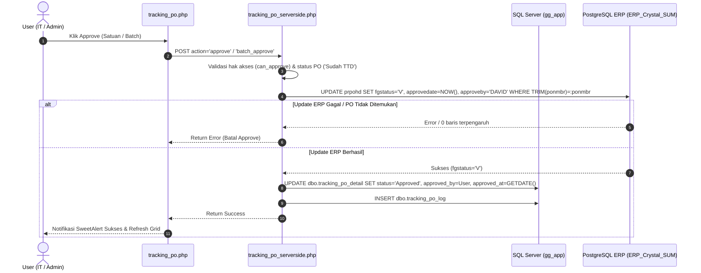

# Rencana Penerapan Logika Approve PO ke Tracking PO

Berdasarkan analisa mendalam terhadap file [`po_approve.php`](file:///c:/xampp/htdocs/gg_app/pages/purchase_order/po_approve.php) & [`proses_approve.php`](file:///c:/xampp/htdocs/gg_app/pages/purchase_order/proses_approve.php), berikut adalah struktur kerja approval PO di sistem ERP dan adaptasinya ke modul [tracking_po](file:///c:/xampp/htdocs/gg_app/pages/purchasing/tracking_po/tracking_po.php).

---

## 1. Analisa Cara Kerja `/pages/purchase_order/po_approve.php`

1. **Target Database**:
   - Terhubung ke database PostgreSQL **`ERP_Crystal_SUM`** melalui koneksi `$conn3` ([`koneksi3.php`](file:///c:/xampp/htdocs/gg_app/koneksi3.php)).
   - Target tabel: **`prpohd`** (Purchase Order Header).

2. **Perubahan Data saat Approve**:
   ```sql
   UPDATE prpohd
      SET fgstatus    = 'V',
          approvedate = :approvedate,
          approveby   = :approveby
    WHERE ponmbr      = :ponmbr
   ```
   - `fgstatus`: diubah dari `'O'` (Open) menjadi `'V'` (Verified/Approved).
   - `approvedate`: waktu approve format `Y-m-d H:i:s` (WIB).
   - `approveby`: `'DAVID'` (standard approver ERP untuk PO, SO, dan SR).

3. **Status Rollback / Unapprove**:
   - Jika di-unapprove, `fgstatus` kembali ke `'O'`, `approvedate` menjadi `NULL`, dan `approveby` menjadi `NULL`.

---

## 2. Kondisi Saat Ini di `tracking_po`

1. **Frontend ([`tracking_po.php`](file:///c:/xampp/htdocs/gg_app/pages/purchasing/tracking_po/tracking_po.php))**:
   - Sudah memiliki tombol **Approve satuan** (`.btn-approve`) pada baris tabel (hanya muncul jika role = IT/Admin dan status = `'Sudah TTD'`).
   - Sudah memiliki **Multi-select Checkbox** dan tombol **Approve Terpilih** (`#btnBatchApprove`) di Floating Action Bar.
   - Frontend sudah mengirim AJAX request ke [`tracking_po_serverside.php`](file:///c:/xampp/htdocs/gg_app/pages/purchasing/tracking_po/tracking_po_serverside.php) dengan action `'approve'` dan `'batch_approve'`.

2. **Backend ([`tracking_po_serverside.php`](file:///c:/xampp/htdocs/gg_app/pages/purchasing/tracking_po/tracking_po_serverside.php))**:
   - Sudah meng-include [`koneksi3.php`](file:///c:/xampp/htdocs/gg_app/koneksi3.php) di awal file.
   - Namun, pada `case 'approve'` dan `case 'batch_approve'`, saat ini **hanya mengupdate tabel lokal SQL Server** (`dbo.tracking_po_detail`) dan menulis ke `dbo.tracking_po_log`.
   - Terdapat catatan:
     ```php
     // TODO: Logika lintas database akan ditambahkan di sini nanti
     // Placeholder untuk proses approval ke sistem lain
     ```
   - Update ke tabel `prpohd` di PostgreSQL belum dieksekusi.

---

## 3. Rencana Adaptasi & Arsitektur Solusi



### Langkah-langkah Penerapan:

### A. Modifikasi `case 'approve'` di [`tracking_po_serverside.php`](file:///c:/xampp/htdocs/gg_app/pages/purchasing/tracking_po/tracking_po_serverside.php)
1. **Validasi Koneksi ERP**:
   Pastikan variabel `$conn3` aktif. Jika terputus, tolak proses dengan pesan error yang jelas.
2. **Kueri Data PO**:
   Ambil `ponmbr` dan pastikan status saat ini adalah `'Sudah TTD'`.
3. **Eksekusi Update ke PostgreSQL (`$conn3`)**:
   - Memakai PDO Prepared Statement dengan `TRIM(ponmbr) = :ponmbr`.
   - Parameter:
     - `:approvedate` = Waktu saat ini (WIB, format `Y-m-d H:i:s`).
     - `:approveby` = `'DAVID'`.
   - Gunakan PDO Transaction (`$conn3->beginTransaction()` dan `commit()`).
   - Cek `rowCount()`. Jika 0 (PO tidak ditemukan di ERP), lempar exception dan batalkan.
4. **Eksekusi Update ke SQL Server (`$conn`)**:
   - Jika ERP sukses, update `dbo.tracking_po_detail` status menjadi `'Approved'`.
   - Catat log lengkap ke `dbo.tracking_po_log` (menyertakan info bahwa `prpohd` di ERP berhasil diset `fgstatus='V'` oleh DAVID).
   - Jika update SQL Server gagal, rollback ERP ke status `'O'` agar data tetap sinkron.

### B. Modifikasi `case 'batch_approve'` di [`tracking_po_serverside.php`](file:///c:/xampp/htdocs/gg_app/pages/purchasing/tracking_po/tracking_po_serverside.php)
1. Siapkan prepared statement PostgreSQL sekali untuk efisiensi eksekusi massal:
   ```sql
   UPDATE prpohd 
      SET fgstatus = 'V', approvedate = :approvedate, approveby = :approveby 
    WHERE TRIM(ponmbr) = :ponmbr AND fgstatus = 'O'
   ```
2. Loop setiap ID PO yang dipilih:
   - Verifikasi status `'Sudah TTD'`.
   - Eksekusi update di PostgreSQL.
   - Jika berhasil di ERP, update status di SQL Server `dbo.tracking_po_detail` dan catat log.
   - Hitung jumlah PO yang berhasil diproses dan kumpulkan nomor PO yang gagal (jika ada).
3. Kembalikan response JSON berisi jumlah berhasil dan rincian pesan.

---

## 4. Parameter & Ketetapan yang Disepakati

| Parameter | Nilai / Kebijakan | Keterangan |
| :--- | :--- | :--- |
| **`approveby` (ERP)** | `'DAVID'` | Sesuai standar ERP pada `po_approve.php`, `sales_order`, & `sales_return` |
| **`approved_by` (Tracking PO)** | Nama login user (IT) | Mencatat siapa personil IT yang mengklik approve di aplikasi |
| **`fgstatus` (ERP)** | `'V'` | Status Approved di tabel `prpohd` |
| **Transaksional** | Fail-safe / Batalkan jika ERP gagal | Menjaga konsistensi data antara Tracking PO & ERP |
| **Fitur Unapprove** | Ditunda (Hanya Approve saat ini) | Sesuai kebutuhan saat ini |
