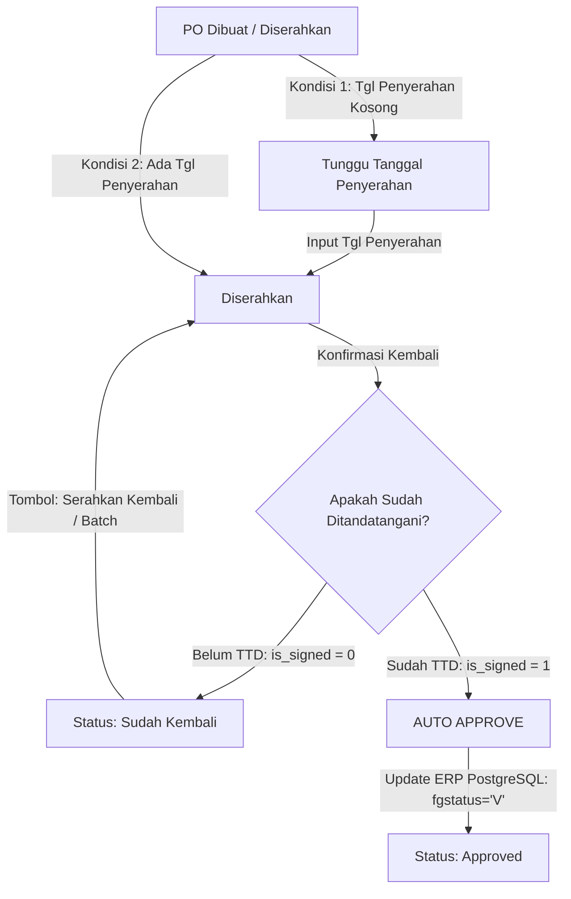

# Rencana Implementasi: Fitur "Serahkan Kembali" & "Auto Approve" Modul Tracking PO

## Ringkasan Tujuan
Sesuai hasil diskusi dan pendalaman melalui `/grill-me`, terdapat 2 perubahan alur bisnis penting pada modul Tracking PO ([tracking_po.php](file:///c:/xampp/htdocs/gg_app/pages/purchasing/tracking_po/tracking_po.php)):
1. **Fitur "Serahkan Kembali"**:
   - Ketika dokumen PO dikembalikan oleh Direktur dalam kondisi **belum ditandatangani** (status `Sudah Kembali`), sediakan tombol aksi baru **"Serahkan Kembali"** pada baris data dan dukungan aksi massal (**batch**) pada Floating Action Bar.
   - Mengklik aksi ini akan memunculkan dialog pop-up (SweetAlert) untuk menentukan tanggal penyerahan kembali fisik dokumen ke Direktur (default hari ini).
   - Status PO akan otomatis berubah kembali menjadi **Diserahkan**, tanggal kembali di-reset (`NULL`), dan tercatat dalam Log History.
2. **Fitur "Auto Approve"**:
   - Ketika Purchasing mengonfirmasi dokumen PO kembali dalam kondisi **sudah ditandatangani** (`is_signed = 1`), sistem akan langsung melakukan **Auto Approve**.
   - Sistem mengeksekusi update ke database ERP PostgreSQL (`prpohd`: `fgstatus = 'V'`, `approveby = 'DAVID'`, `approvedate = NOW()`) secara atomik.
   - Status data di tabel tracking lokal langsung berubah menjadi **Approved** (tercatat `approved_by` dan `approved_at`).
   - Tombol "Approve" manual dihilangkan karena seluruh approval berpindah ke mekanisme Auto Approve ini.
   - Summary Card **Sudah TTD** tetap dipertahankan sebagai data riwayat/arsip.

---

## Hasil Wawancara Desain (/grill-me)
Keputusan desain yang disepakati bersama user:
1. **Alur Tanggal Serahkan Kembali**: Menggunakan dialog SweetAlert dengan datepicker (default tanggal hari ini) agar user dapat menyesuaikan tanggal jika diperlukan.
2. **Dukungan Batch**: Fitur "Serahkan Kembali" didukung baik untuk single row maupun batch selection di Floating Action Bar.
3. **Penanganan Error ERP**: Transaksi atomik penuh. Jika koneksi atau update ke ERP PostgreSQL gagal, proses konfirmasi dibatalkan (rollback) dan error ditampilkan ke user untuk menjamin konsistensi data 100%.
4. **Tombol Approve Manual**: Ditiadakan karena seluruh proses approve terintegrasi secara otomatis saat dokumen kembali sudah ditandatangani.
5. **Kartu Summary "Sudah TTD"**: Tetap dipertahankan untuk arsip data.

---

## Diagram Alur Dokumen Baru



---

## User Review Required
> [!IMPORTANT]
> 1. **Hak Akses "Serahkan Kembali"**: Diberikan kepada Purchasing dan Administrator (`userPerms.can_confirm` / `userPerms.can_input`).
> 2. **Auto Approve ERP**: Dijalankan secara otomatis saat konfirmasi pengembalian dengan kondisi TTD. Approval di ERP dicatat atas nama `DAVID` sesuai standar sistem approval ERP GG. Jika update ERP gagal, proses dibatalkan dan status tidak berubah.
> 3. **Peniadaan Tombol Manual Approve**: Tombol centang hijau manual di tabel dan floating bar dihilangkan karena alur approve sekarang sepenuhnya otomatis.

---

## Perubahan File yang Diusulkan

### 1. Backend: [tracking_po_serverside.php](file:///c:/xampp/htdocs/gg_app/pages/purchasing/tracking_po/tracking_po_serverside.php)

#### [MODIFY] `konfirmasi_kembali` & `batch_konfirmasi_kembali`
- Modifikasi logika saat `$isSigned == 1`:
  - Lakukan koneksi dan transaksi ke PostgreSQL ERP (`conn3`).
  - Update `prpohd`: `fgstatus = 'V'`, `approveby = 'DAVID'`, `approvedate = date('Y-m-d H:i:s')` di mana `TRIM(ponmbr) = :ponmbr`.
  - Jika update ERP berhasil:
    - Update SQL Server `tracking_po_detail`: `status = 'Approved'`, `is_signed = 1`, `tanggal_kembali = $today`, `approved_by = $currentUser['formatted']`, `approved_at = GETDATE()`.
    - Catat di `tracking_po_log`: action `'Konfirmasi Kembali'` dengan keterangan `"Dokumen PO {$ponmbr} sudah kembali dan ditandatangani. Auto Approved di ERP (fgstatus='V')."`.
  - Jika update ERP gagal:
    - Rollback transaksi ERP dan kembalikan response error JSON.

#### [NEW ACTION] `serahkan_kembali`
- Aksi untuk mengembalikan status PO dari `Sudah Kembali` menjadi `Diserahkan`.
- Parameter: `detail_id`, `tanggal_penyerahan`, `catatan` (opsional).
- Validasi: Status PO saat ini harus `Sudah Kembali`.
- Query Update:
  ```sql
  UPDATE dbo.tracking_po_detail 
  SET status = 'Diserahkan', 
      tanggal_kirim = ?, 
      tanggal_kembali = NULL, 
      konfirmasi_oleh = NULL, 
      konfirmasi_at = NULL, 
      is_signed = 0,
      catatan = ?
  WHERE id = ?
  ```
- Insert ke `tracking_po_log`:
  - `action`: `'Serahkan Kembali'`
  - `old_status`: `'Sudah Kembali'`
  - `new_status`: `'Diserahkan'`
  - `keterangan`: `"PO diserahkan kembali ke Direktur pada tanggal {$tanggalPenyerahan}."`

#### [NEW ACTION] `batch_serahkan_kembali`
- Aksi massal untuk menyerahkan kembali beberapa PO sekaligus yang berstatus `Sudah Kembali`.
- Parameter: `detail_ids` (array), `tanggal_penyerahan`, `catatan` (opsional).
- Menjalankan update dan log untuk setiap item valid.

---

### 2. Frontend: [tracking_po.php](file:///c:/xampp/htdocs/gg_app/pages/purchasing/tracking_po/tracking_po.php)

#### [MODIFY] Table Row Action Buttons (`loadData()`)
- Tambahkan tombol aksi **Serahkan Kembali** jika `row.status === 'Sudah Kembali'` dan user memiliki izin Purchasing/Admin:
  ```html
  if (userPerms.can_confirm && row.status === 'Sudah Kembali') {
      aksiHtml += '<button class="btn btn-primary btn-serahkan-kembali" data-id="' + row.detail_id + '" data-ponmbr="' + row.ponmbr + '" title="Serahkan Kembali ke Direktur"><i class="fas fa-redo"></i></button>';
  }
  ```
- Hapus/nonaktifkan tombol aksi manual Approve (`btn-approve`) dari tabel baris.

#### [MODIFY] Floating Action Bar & Batch Selection
- Tambahkan tombol batch **Serahkan Kembali Terpilih** pada floating bar (`#batchGroupSerahkanKembali`):
  ```html
  <div id="batchGroupSerahkanKembali" style="display: none;">
      <button type="button" class="btn btn-primary btn-sm font-weight-bold" id="btnBatchSerahkanKembali">
          <i class="fas fa-redo mr-1"></i> Serahkan Kembali Terpilih
      </button>
  </div>
  ```
- Pada fungsi `syncBatchCheckboxes()`:
  - Deteksi jika baris yang dipilih semuanya berstatus `Sudah Kembali`, set `batchMode = 'serahkan_kembali'`.
- Pada fungsi `updateBatchFloatingBar()`:
  - Tampilkan `#batchGroupSerahkanKembali` dan badge `#floatingModeBadge` jika `batchMode === 'serahkan_kembali'`.
  - Hapus/sembunyikan `#batchGroupApprove`.

#### [NEW] Event Handlers JavaScript
- Click handler `.btn-serahkan-kembali`:
  - Buka SweetAlert dengan input datepicker (default hari ini) dan textarea catatan opsional.
  - Kirim AJAX ke `action: 'serahkan_kembali'`.
  - Refresh tabel dan summary cards saat sukses.
- Click handler `#btnBatchSerahkanKembali`:
  - Buka SweetAlert massal untuk input tanggal penyerahan kembali.
  - Kirim AJAX ke `action: 'batch_serahkan_kembali'`.
  - Refresh tabel dan summary cards saat sukses.
- Tambahkan helper warna log dot untuk aksi `'Serahkan Kembali'` (`#3b82f6`).

---

## Verification Plan

### Automated / Scratch Script Testing
1. Buat test script scratch `test_serahkan_dan_auto_approve.php`:
   - Validasi sintaks PHP dengan `php -l`.
   - Simulasikan siklus penuh:
     1. Buat data dummy tracking berstatus `Diserahkan`.
     2. Eksekusi `konfirmasi_kembali` dengan `is_signed = 0` -> verifikasi status menjadi `Sudah Kembali`.
     3. Eksekusi `serahkan_kembali` -> verifikasi status kembali menjadi `Diserahkan`, `tanggal_kembali` menjadi `NULL`, dan log tercatat.
     4. Eksekusi `konfirmasi_kembali` dengan `is_signed = 1` -> verifikasi Auto Approve berjalan (ERP update dan status lokal langsung `Approved`).
     5. Bersihkan data uji setelah selesai.

### Manual Verification
1. Buka browser pada halaman [tracking_po.php](file:///c:/xampp/htdocs/gg_app/pages/purchasing/tracking_po/tracking_po.php).
2. Konfirmasi sebuah PO yang berstatus `Diserahkan` dengan opsi **Belum TTD**. Pastikan status berubah menjadi **Sudah Kembali**.
3. Periksa baris PO tersebut: pastikan muncul tombol biru dengan ikon putar (`btn-serahkan-kembali`).
4. Klik tombol **Serahkan Kembali**:
   - Pilih tanggal hari ini pada pop-up SweetAlert.
   - Simpan dan pastikan status PO kembali menjadi **Diserahkan**.
5. Centang beberapa PO berstatus `Sudah Kembali` untuk menguji aksi massal:
   - Pastikan floating action bar menampilkan mode **Serahkan Kembali Terpilih**.
   - Simpan tanggal massal dan pastikan seluruh PO berubah menjadi **Diserahkan**.
6. Konfirmasi kembali sebuah PO dengan opsi **Sudah TTD**:
   - Pastikan status PO langsung berubah menjadi **Approved**.
   - Pastikan di database ERP PostgreSQL status PO menjadi `'V'` dengan approveby `'DAVID'`.
   - Pastikan tombol approve manual sudah tidak muncul.
